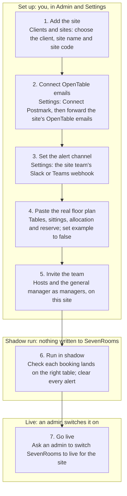

# Table Runner: managing your sites as a client admin

Last updated 1 November 2026. For client admins. Related guides:
[admin-named-accounts.md](admin-named-accounts.md),
[manager-setting-the-reserve.md](manager-setting-the-reserve.md) and
[host-daily-routine.md](host-daily-routine.md). "Us" in this guide means
Williams, Stanley & Co, who run Table Runner.

## Your role

As a client admin you run your own group's sites in Table Runner, without needing us for day-to-day changes. You open new sites, keep each site's settings right, and look after your team's accounts. Everything is limited to the clients you have been given, for example Open House and every site under it.

| You can | Only an admin can |
| --- | --- |
| Add sites to your clients, rename them, move them between your clients, archive and reopen them | Add, rename, archive or delete clients |
| Open each site's Settings: OpenTable emails in, alerts, SevenRooms, floor plan and reserve | Set up email sending for invites and resets (the Email tab) |
| Add and look after users whose access lies wholly inside your clients, including other client admins | Create admins, or give anyone access to every site |
| Act on alerts, run releases and reconciliation, mark tables closed, like a manager | Change your own role or your own clients |
| See the Admin log for your clients | See the Admin log for other clients |

The rule of thumb: anything inside your group is yours; anything that affects the whole install or another group comes to us.

## Opening a new site

A new site is yours to set up end to end, up to the switch to live. It starts in shadow mode on the example floor plan, so nothing reaches SevenRooms until it is ready.

The site code in step 1 is permanent: lower-case letters, digits and hyphens, 2 to 40 characters, for example broadcaster. Connect Postmark from the public Table Runner address, not one behind Vercel's login, or Table Runner refuses. In the shadow run, compare each synced booking with SevenRooms and keep the hosts on their normal routine; the dashboard banner shows shadow mode until live.

## Each site's Settings

Every site has its own Settings screen. Open it from the Settings button on the dashboard with that site chosen, or from Admin, Clients and sites, Settings beside the site. Press Save settings after any change; a wrong value is refused with a reason, and nothing changes.

| Section | What it is for | What to do |
| --- | --- | --- |
| OpenTable emails in | How OpenTable bookings reach Table Runner for this site | In Postmark, create a server for the site and copy its Server API token. Paste it and press Connect Postmark, from the public Table Runner address. Then forward the site's OpenTable emails to the address shown. |
| Webhook address | The private address Postmark posts emails to | Set automatically. Treat it like a password. New key stops the old address at once and re-points Postmark. |
| Alerts | Where alerts go besides the dashboard | Paste a Slack or Teams incoming webhook for the site's team channel. Strongly recommended: hosts see red alerts away from the screen. |
| SevenRooms | The connection to the site's SevenRooms | Leave in Shadow until we say live mode is ready. Client ID, client secret and venue ID come from SevenRooms; the secret is stored encrypted. |
| Floor plan and OpenTable allocation | Tables, sittings, protected OpenTable tables by weekday, release time and reserve | Paste the site's real floor plan and set "example" to false. The reserve is release.holdBack; see the manager guide. The venue code cannot change. |

One site's settings never affect another. Each site has its own Postmark server, webhook address, alert channel and floor plan.

## Your team

You add and look after accounts for anyone whose access lies wholly inside your clients. Use Admin, then the Users tab. Each person gets their own account; nobody shares a sign-in.

1. Fill in Name and Email (their sign-in). Use their own work email.
2. Choose the role:
    - Manager for every host and the general manager. They can act on alerts and mark tables closed.
    - Viewer for anyone who only needs to look, such as finance.
    - Client admin for someone who will run sites with you. A client admin is given whole clients, never single sites.
3. Choose access. Tick a whole client to cover every site it has now and adds later, or tick single sites, for example only Broadcaster for a Broadcaster host.
4. Choose how they get in. Email an invite if email sending is set up: the link works once and lasts 7 days. Otherwise set a password of 10 characters or more and give it to them in person or by phone.
5. Press Add user.

After that, from each person's row: Resend invite, Send reset link, Edit to change role or access (they are signed out at once), Disable for a leaver on their last day, Delete only if they will never return.

What you will be refused, and why: making someone an admin, giving access to a site outside your clients, editing a user who also has access outside your clients, and changing your own role or clients. Those come to us. If the invite option is greyed out, email sending is not set up yet; that is ours too.

## Changing a site

All from Admin, Clients and sites, on the site's row.

| Change | How | What happens |
| --- | --- | --- |
| Rename | Edit, new name, save | Staff see the new name everywhere. The site code stays the same, so bookings and history are untouched. |
| Move to another of your clients | Edit, choose the client, save | Anyone with access to the old client loses it; anyone with access to the new client gains it. Check the Users tab afterwards. You can only move a site between clients you hold. |
| Archive, for a site that closes or pauses | Archive, then click again to confirm | It stops taking OpenTable emails (Postmark is told to stop retrying), stops releases and reconciliation, and disappears for managers and viewers. Bookings are kept. |
| Reopen | Reopen | Everything resumes. Reconnect Postmark if the forwarding was switched off, and check the floor plan is still right. |

What cannot change: the site code. It keys the site's bookings and is fixed when the site is added. Choose it carefully, for example broadcaster, not bcast-temp.

Sites are never deleted, only archived. The last active site on the whole install cannot be archived.

## Weekly checks, and when to come to us

Ten minutes a week, in Admin:

- [ ] Overview, Needs attention: no site without a Postmark connection, no site still on the example floor plan, no invites outstanding or expired
- [ ] Each live site's dashboard: the Open in OpenTable tile is not red, and no red alert is more than 30 minutes old
- [ ] Users: leavers disabled, nobody with more access than their job needs
- [ ] Admin log, filtered to your clients: every change is one you expected

Come to us when:

- You need a new client, or a client renamed, archived or deleted.
- Someone needs to be an admin, or needs access beyond your clients.
- Invites or password resets are not arriving.
- A site is ready to switch SevenRooms from shadow to live.
- OpenTable oversells at any of your sites. Every one is reviewed.
- Settings refuses a save and the message is unclear.
