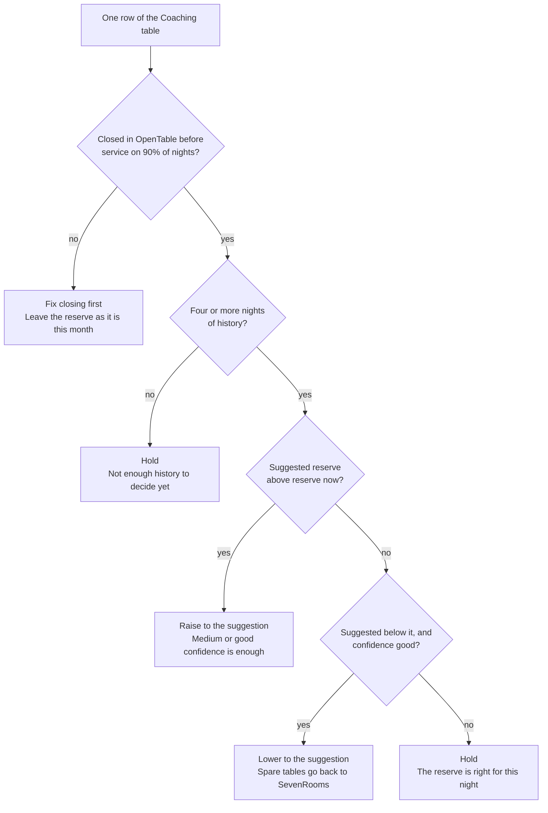

# Table Runner: setting the OpenTable reserve

Last updated 31 October 2026. For managers. The host routine is in
[host-daily-routine.md](host-daily-routine.md); the background is in
[opentable-exposure.md](opentable-exposure.md).

## The decision

The reserve is the number of unsold OpenTable tables Table Runner holds back at release, per sitting. Your job is to set it just large enough to absorb the OpenTable bookings that arrive after release, and no larger.

Why it exists: Table Runner cannot close tables in OpenTable. A table released to SevenRooms stays bookable on OpenTable until a host closes it by hand. Any OpenTable booking that arrives after release goes onto a reserve table. When the reserve is empty and released tables are still open, OpenTable can sell a table SevenRooms has already sold.

The trade-off runs both ways:

| Reserve set | What it costs |
| --- | --- |
| Too small | Double bookings. A guest arrives to find their table taken. This is the expensive mistake. |
| Too large | Tables held back from SevenRooms that it could have sold, often for two days. Lost covers, every night. |

The rule: cover 9 nights in 10 with the reserve, and let the hosts' habits and the alerts handle the tenth. Covering every night means holding tables back for the rare spike, which costs covers on all the other nights.

## Where Broadcaster starts

Broadcaster starts on one reserve table per sitting, and two on Friday and Saturday late. Table Runner set these figures itself on the first request after the update, and logged the change in the activity log.

| Sitting | Reserve |
| --- | --- |
| Every sitting, Monday to Thursday and Sunday | 1 |
| Friday and Saturday early | 1 |
| Friday and Saturday late | 2 |

Why these figures: weekend late sittings take the most last-minute OpenTable demand, and we have no history yet to say otherwise. Leave them alone for the first four weeks. Changing a figure before the model has evidence is guessing.

Which tables are held: Table Runner keeps the largest unsold tables first. A four-top can take a late two, but a two-top cannot take a late four. The figures above are numbers of tables, not covers.

## Reading the Coaching table

The evidence is the table headed What the model has learned, per night, in the dashboard's Coaching section. One row per weekday and sitting. A late booking means an OpenTable booking that arrived after release time.

| Column | What it tells you | How to use it |
| --- | --- | --- |
| Nights | Nights of history for this row. One per week. | Fewer than 4: ignore the row. 4 to 7: act only on a clear signal. 8 or more: trust it. |
| Late, average | Late bookings per night, plain average | The everyday level. |
| Late, worst | The busiest night seen | The spike the reserve may not cover. That is expected. |
| Expected late | The model's forecast for the next night | Recent weeks count most: a week from a month ago counts half as much as last week. Nights with little history lean on the venue average. |
| Trend | Last four weeks against the four before | Rising: look again next month even if the figure holds. |
| Suggested reserve | The smallest reserve that covers 9 nights in 10 under the forecast | Your target figure. Blank until the row has 4 nights. |
| Reserve now | The current figure for this row | Compare with the suggestion. |
| Confidence | Low under 4 nights, medium 4 to 7, good 8 or more | Raise on medium or good. Lower only on good. |
| Sold by release | Share of the OpenTable allocation sold before release time | Not the reserve. It sizes the allocation (see the review section). |
| Allocation | One more, one fewer or hold, from sold by release | A separate decision from the reserve. |

Worked example: Saturday late shows 8 nights, late average 1.2, worst 3, expected late 1.1, suggested reserve 2, reserve now 2, confidence good. The reserve is right. On a busy night, the second late booking empties the reserve and triggers a red alert. The host stops online sales for the sitting, so a third never lands. That is the system working, not failing.

## Deciding

Take each row of the table through the same four questions, in order. Most months most rows end at Hold, and that is the normal answer.



The order matters. Habits come first because a slow close inflates late demand. History comes second because four nights is the least the model needs. Raising needs less proof than lowering, because a reserve that is too small costs a guest, while one that is too large costs covers.

## Making the change on Settings

The reserve lives in the floor plan, under release, as holdBack. Only the admin password opens Settings.

1. Sign in with the admin password and press Settings.
2. In Floor plan and OpenTable allocation, find the release block.
3. Change the holdBack figures.
4. Press Save settings. If anything is wrong, Table Runner refuses the save and says which line, and nothing changes.
5. Check the activity log shows Settings changed: floor plan.

Broadcaster's current setting:

```json
"release": {
  "daysBefore": 2,
  "time": "16:00",
  "holdBack": {
    "default": 1,
    "fri": { "late": 2 },
    "sat": { "late": 2 }
  }
}
```

How Table Runner picks the figure for a sitting, first match wins:

1. The weekday entry for that sitting, for example `"sat": { "late": 3 }`.
2. A weekday given as a plain number covers every sitting that day, for example `"sun": 0`.
3. A sitting entry, for example `"late": 2`, covers that sitting on every other day.
4. `"default"` covers everything else.

Example: raise Saturday late to 3 and drop Monday to none.

```json
"holdBack": {
  "default": 1,
  "mon": 0,
  "fri": { "late": 2 },
  "sat": { "late": 3 }
}
```

When it takes effect: at the next release run, a few minutes past the hour. Lowering a figure also hands back the spare reserve on dates already released, at that same run. Raising a figure does not pull back tables already released. It applies from the next release, so a rise for Saturday made on Thursday after 16:00 starts the following week.

## The monthly review

Once a month, 20 minutes, first week of the month. The reserve and the allocation are reviewed together because they pull on each other.

1. Check the habits first, in Team habits, week by week. If released tables are closed in OpenTable before service on fewer than 90% of nights, fix that before touching the reserve. A slow close makes late demand look bigger than it is, and you would be paying for a habit problem with covers.
2. Read the Coaching notes headed Reserve size. They name the nights the model says to raise or lower.
3. Go through the table row by row using the decision path above. Change no more than two rows a month.
4. Then the allocation. Sold by release above 90%, with the sitting full before release on at least half its nights: one more OpenTable table. Below 50%: one fewer. Change one night at a time.
5. Write down what you changed and why, with the date. The activity log records that a change was made, not your reason.

After a change, check four weeks later:

- Reserve ran out: down, or still no more than once a month.
- OpenTable oversold: still zero.
- Suggested reserve now matches reserve now for the rows you changed.
- For a lowered reserve: no red alerts on those nights that were not there before.

If a change made things worse, put the old figure back. That is a result, not a failure: the model now has evidence it lacked.

## Common mistakes and when to escalate

Mistakes:

- Raising the reserve after one bad night. One spike is the night in ten the reserve is not meant to cover. Wait for the model.
- Lowering on a medium-confidence row. Fewer than 8 nights of history cannot show you a rare spike.
- Using the reserve to fix slow closing. Fix the habit; it costs nothing.
- Changing the reserve and the allocation for the same night in the same month. You cannot tell which change did what.
- Setting a reserve larger than the tables still likely to be unsold at release. Table Runner can only hold back what is unsold, so the extra does nothing.
- Editing other parts of the floor plan while in there. Change holdBack only, unless the floor plan itself has changed.

Escalate to the CEO or the sync owner when:

- OpenTable oversells, even once. Every one is a guest at risk and is reviewed.
- The reserve runs out more than twice in a month on the same night after you have raised it.
- The suggested reserve for a night exceeds half its OpenTable allocation. That night's demand pattern needs a different answer, such as a later release time.
- Settings refuses a save and the message is unclear.
